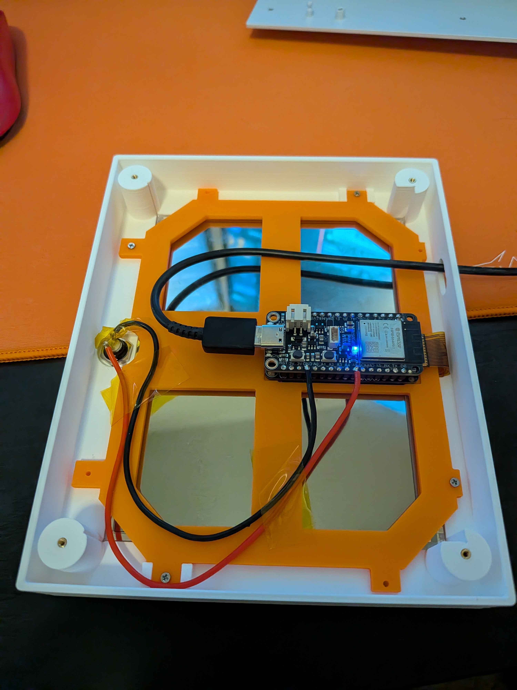
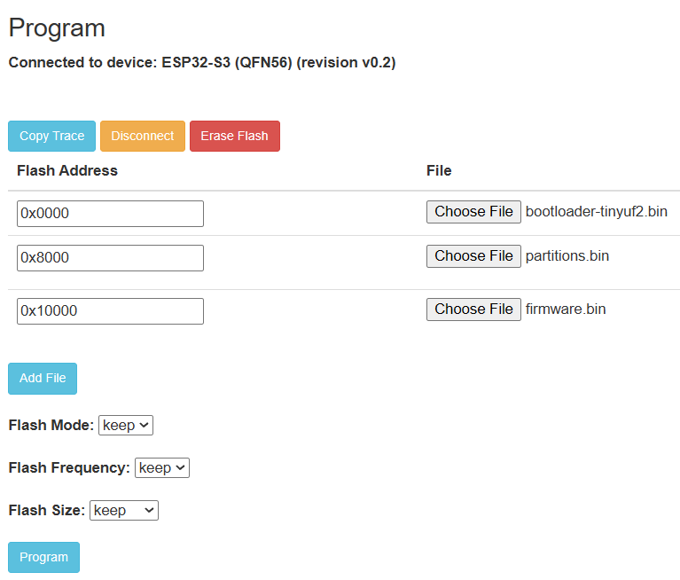

# EPaper-Dashboard

A Windows desktop app that drives a 5.83" e-paper display showing live system stats, weather, sports scores, and more. Designed to mount on any flat 6.25" × 5" surface.

> **Disclaimer:** This software is provided as-is with no warranty. Use at your own risk. The author is not responsible for any damage to hardware, data loss, or other issues arising from the use of this software.

> **Hardware Warning:** This project is built for specific hardware listed below. It will not work with other hardware without modifying the ESP32 firmware and Python source. You must flash the ESP32 firmware yourself before running the dashboard.


## Hardware Required

**Electronics**
- **Adafruit ESP32-S3 Feather**
- **Adafruit eInk Feather Friend**
- **5.83" e-paper panel** (648×480, monochrome — Waveshare/Seeed GDEQ0583T31, UC8179 controller)
- 8mm momentary switch (generic)
- USB data cable (not charge-only)
- ~10 inches of wire

**Assembly**
- 12x M1.6 heat set inserts (5mm long)
- 14x M1.6 5mm flat round head screws
- 2x M1.6 hex nuts
- ~70 grams of filament (for 3D printed parts)


## How It Works

The PC renders each display page using Python + Pillow, converts it to 1-bit, and sends the raw bytes over USB serial to the ESP32. The ESP32 firmware simply receives the data and blits it to the e-paper panel. All logic runs on the PC — the ESP32 is just a display driver.


## Pages

| Page | What it shows |
|---|---|
| System | CPU/GPU temp, usage, RAM, disk, Wi-Fi signal — with sparkline history |
| Clock | Large clock and date with current weather conditions |
| Weather | 4-panel forecast grid |
| Sports Calendar | Upcoming games for your team |
| Plex | Now playing on your Plex server |
| Proxmox | VM/container status from your Proxmox node |
| Fact | A random fact, refreshed daily |

Pages are enabled/disabled in `config.yml`. Press the button on the ESP32 to cycle through enabled pages.


## Step 1 — 3D Print & Assemble

Two STL files are included in the release:

- `faceplate.STL` — the front panel that holds the e-paper display
- `ePaperRetainer.STL` — the bracket that secures the display from behind



1. Install the 12 heat set inserts into the holes of the 3D printed parts
2. Place the e-paper display into the faceplate with the ribbon cable pointed away from the button hole
3. Use two bolts and hex nuts to secure the ESP32 and eInk Feather Friend to the ePaperRetainer (refer to image above)
   > **Note:** When soldering the eInk Feather Friend to the ESP32, orient it so the microSD card slot faces toward the ESP32 and the ribbon cable retainer faces toward the ESP32 antenna.
4. Plug the ribbon cable into the eInk Feather Friend
5. Screw the ePaperRetainer down onto the faceplate
6. Solder one 5" wire to the **A5 (GPIO8)** pin on the ESP32 and another 5" wire to a **GND** pin
7. Solder each of those wires to a separate leg of the button


## Step 2 — Flash the ESP32 Firmware

The pre-built firmware files are included in the [Releases](../../releases) page. You will need three files:

- `bootloader-tinyuf2.bin`
- `partitions.bin`
- `firmware.bin`

### Flashing with the Espressif Web Flasher (no installs required)

1. Open [espressif.github.io/esptool-js](https://espressif.github.io/esptool-js) in **Chrome**
2. Set the baud rate to **115200**
3. Click **Connect** and select the ESP32's COM port
4. Add three file rows using **Add File**, and set them up as follows:

| Flash Address | File |
|---|---|
| `0x0000` | `bootloader-tinyuf2.bin` |
| `0x8000` | `partitions.bin` |
| `0x10000` | `firmware.bin` |

5. Click **Program**
6. When you see `Hard resetting via RTS pin...` in the output, press the **RESET** button on the ESP32




## Step 3 — Install the Desktop App

1. Download `EPaperDashboard_Setup.exe` from the [Releases](../../releases) page
2. Run the installer
3. On first launch, a config file will open in Notepad — fill in your API keys, save, and close
4. The dashboard will start and appear in the system tray


## Configuration

Your config file lives at:
```
%APPDATA%\EPaperDashboard\config.yml
```

You can also open it anytime via the system tray icon → **Open Config**, then right-click the tray icon → **Force Refresh** to apply changes.

### API Keys (only needed for pages you enable)

| Page | Key needed | Where to get it |
|---|---|---|
| Weather / Clock | OpenWeatherMap API key | [openweathermap.org](https://openweathermap.org/api) (free tier) |
| Sports Calendar | No key needed | — |
| Plex | Plex token | Your Plex server settings |
| Proxmox | API token | Your Proxmox node → Datacenter → API Tokens |
| Fact | No key needed | — |


## Building from Source

See [Software/Desktop/BUILD.md](Software/Desktop/BUILD.md) for full build instructions.


## License

[MIT](LICENSE)
